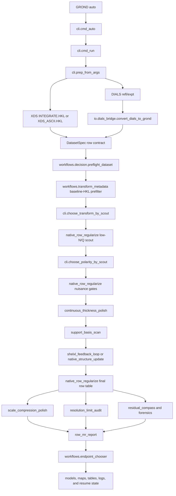
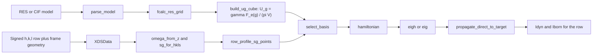

# GROND Code Map

This file is the practical reading map for the GROND source tree. If you only want the core numerical path, read `src/grond/legacy/engine/bloch_engine.py`, then `src/grond/legacy/engine/native_row_regularize.py`, then `src/grond/cli.py`. The first file builds the electron structure-factor grid, constructs the Bloch-wave Hamiltonian, and predicts row intensities. The second file uses those predictions to regularize row-level nuisance terms, scales, corrected intensities, and endpoint statistics. The third file wires the whole automatic workflow together.

The `legacy/engine` name is historical. In the current package it is still where the mature command-line numerical engine lives. The public package namespaces in `src/grond/io`, `src/grond/workflows`, `src/grond/forensics`, and the top-level CLI call into those engine scripts.

## Short Answer

The central numerical file is `src/grond/legacy/engine/bloch_engine.py`.

That file reads XDS-like row data through `XDSData`, reads the structural model through `parse_model`, calculates electron structure factors through `fcalc_res_grid`, converts them to Fourier potential coefficients in `XDSBlochPort.build_ug_cube`, selects the direct beam, target reflection, and support beams in `XDSBlochPort.select_basis`, builds the matrix in `XDSBlochPort.hamiltonian`, and propagates the direct beam to the target beam in `XDSBlochPort.propagate_direct_to_target`. `XDSBlochPort.predict_rows` repeats that calculation over the selected rows, rocking-profile quadrature points, and thickness quadrature points.

The main regularization wrapper is `src/grond/legacy/engine/native_row_regularize.py`. It calls `XDSBlochPort.predict_rows`, fits frame or compact scale terms, evaluates native and GROND row/MR residuals, writes `native_dyn_calc.csv`, and exports the corrected no-EXTI reflection endpoint. `src/grond/cli.py` then decides which stages to run, when to scout transforms and polarity, when to polish continuous thickness, when to run the SHELXL feedback loop, when to combine datasets, and when to write publication reports.

## Source Tree

```text
src/grond/
  __main__.py                    console entry point for python -m grond
  cli.py                         GROND auto, run, prep, doctor, validate, and workflow orchestration
  runtime.py                     external executable discovery and configured tool paths
  progress.py                    progress logging, timing, and resume ledger helpers
  accelerators.py                optional backend detection and acceleration metadata

  io/
    config.py                    prep JSON and dataset CSV parsing
    dials_bridge.py              DIALS refl/expt to GROND row-contract conversion

  bloch/
    contracts.py                 public kernel contracts and row-field expectations
    matrix.py                    small public matrix helpers used by tests and documentation

  workflows/
    decision.py                  preflight, transform candidates, and bad-data stop decisions
    transform_metadata.py        baseline-HKL transform prefilter before Bloch scouts
    dataset_policy.py            multi-dataset include, downweight, completeness-only, exclude policy
    endpoint_chooser.py          publication endpoint selection and rejection reasons

  forensics/
    resolution.py                shell-stability and resolution-limit logic

  legacy/engine/
    bloch_engine.py              core structure factors, U_g grid, Sg geometry, Hamiltonian, Bloch propagation
    native_row_regularize.py    row-level dynamical nuisance regularization and corrected endpoint export
    continuous_thickness_polish.py  continuous thickness and thickness-gradient polish from cached eigensystems
    support_basis_scan.py        final N recommendation from observed support-beam requirements
    shelxl_feedback_loop.py      fast Bloch -> one least-squares step -> Bloch endpoint loop
    native_structure_update.py   native finite-difference single-dataset coordinate/ADP regularization
    native_multi_structure_update.py  shared-model multi-dataset finite-difference regularization
    combine_native_nuisance_runs.py  corrected-HKL combination and overlap scaling across datasets
    row_mr_report.py         raw and merged residual tables
    scale_compression_polish.py  compact frame-scale manifold promotion
    resolution_limit_audit.py    row-table shell audit and suggested resolution endpoint
    map_hydrogen_omit_audit.py   no-H difference-map and hydrogen-visibility audit
    residual_compass.py          row-space trend and forensic summaries
```

## Automatic Workflow



For multi-dataset jobs, `cli.run_multi` runs the same per-dataset gates, then `workflows.dataset_policy` assigns each crystal to the primary, downweight, completeness-only, or exclude role. `native_multi_structure_update.py` processes the shared native-gradient diagnostic when requested, and `combine_native_nuisance_runs.py` performs the corrected-HKL merge with one overlap scale per accepted dataset before endpoint tables are written.

## Single-Row Bloch Calculation



The row identity is always the signed reflection plus its observation geometry. For XDS input, `XDSData` reads the row, header geometry, detector position, frame number, and intensity columns. For DIALS input, `io.dials_bridge` converts `.refl` and `.expt` into the same row contract and writes the scan-point orientation sidecar that lets `XDSData` evaluate the correct frame-dependent reciprocal basis.

## Matrix Construction

The Bloch calculation uses a basis ordered as direct beam, target reflection, then support beams. For a basis of `N` reciprocal-lattice vectors `g_i`, `XDSBlochPort.hamiltonian` builds an `N x N` complex matrix. The diagonal term is the excitation error for each beam,

```text
H_ii = S(g_i)
```

and the elastic off-diagonal coupling is the Fourier potential difference between beam `i` and beam `j`,

```text
H_ij = U(g_j - g_i) / (2 k)
```

where `k` is the electron wave-vector length. Absorption-like terms, when explicitly accepted by the automatic gates or requested by the user, add imaginary diagonal or off-diagonal terms and switch propagation from Hermitian `eigh` to general complex `eig`.

For a three-beam example with direct beam `0`, target beam `g`, and one support beam `q`, the matrix has this shape:

```text
          direct              target g            support q
direct    S(0)                U(g-0)/(2k)         U(q-0)/(2k)
target    U(0-g)/(2k)         S(g)                U(q-g)/(2k)
support   U(0-q)/(2k)         U(g-q)/(2k)         S(q)
```

`XDSBlochPort.propagate_direct_to_target` evaluates the matrix exponential through the eigensystem,

```text
psi(t) = exp(2 pi i H t) psi(0)
```

and returns the squared amplitude transferred from the direct beam into the target beam. `XDSBlochPort.predict_rows` repeats this over the rocking-profile quadrature points and thickness quadrature points. The default accumulation stores summed sub-exposure intensity so that future raw detector forward models use the same count convention as the integrated data.

## Where Regularization Happens

`native_row_regularize.py` is the row-level regularization workhorse. It chooses the target intensity columns, inflates sigmas when accepted nuisance terms require that, calls `predict_with_cache` to obtain dynamic and Born predictions, fits group or detector scale contracts, evaluates work/free and all-row metrics, writes `native_dyn_calc.csv`, and exports corrected no-EXTI HKL files. This is the main place to inspect when a run gives suspicious raw-row R factors or odd scale behavior.

`continuous_thickness_polish.py` is the fast thickness polish. It caches eigensystems from a selected row subset, then searches continuous thickness and thickness-gradient values without rebuilding every Hamiltonian for every scalar trial. This is why modern auto runs can report non-round thicknesses rather than only the coarse grid value.

`shelxl_feedback_loop.py` is the default fast single-dataset full-mode structure feedback loop when SHELXL is configured. It runs a high-N/Q Bloch correction, performs one least-squares update, promotes the active weighting line, and repeats. The native finite-difference alternatives are `native_structure_update.py` for one dataset and `native_multi_structure_update.py` for shared multi-dataset regularization.

`scale_compression_polish.py` is where dense frame scales are replaced by a compact, smooth scale manifold when that does not hurt all-row residuals beyond the accepted penalty. `resolution_limit_audit.py` and `forensics/resolution.py` decide whether the final endpoint should be reported at the requested resolution or a suggested shell-stable resolution. `row_mr_report.py` writes the manuscript-facing raw and merged residual tables.

## How To Follow A Real Run

Start at the run directory, then read `grond_progress.json` and the `logs/` directory to see which stage ran and how long it took. For a single-dataset job, the strongest numerical artifacts are usually `final/native_dyn_calc.csv`, `final/summary.json`, `scale_polish/summary.json`, `resolution_limits/*/summary.json`, `tables/publication_table.md`, and `publication_endpoint_choice/REPORT.md`. For a multi-dataset job, also read `dataset_policy/` and the combined endpoint directory.

To debug the physics for one row, trace this path:

```text
native_dyn_calc.csv row
  -> XDSData row index and transformed h,k,l
  -> XDSBlochPort.row_profile_sg_points
  -> XDSBlochPort.select_basis
  -> XDSBlochPort.hamiltonian
  -> XDSBlochPort.propagate_direct_to_target
```

To debug why auto promoted or rejected a correction, trace this path:

```text
cli.run_single or cli.run_multi
  -> native_row_regularize summary.json
  -> feature gate output directory
  -> scale_compression_polish summary.json
  -> resolution_limit_audit summary.json
  -> endpoint_chooser report
```

This is also the safest entry point for new contributors. Changes to file parsing should start in `src/grond/io`. Changes to automatic decisions should start in `src/grond/workflows`. Changes to residual interpretation should start in `src/grond/forensics` or `src/grond/legacy/engine/row_mr_report.py`. Changes to the actual Bloch physics should start in `src/grond/legacy/engine/bloch_engine.py`, with tests in `tests/test_bloch_contract.py` and any new numerical-contract tests needed to pin the behavior.
