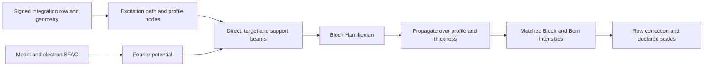
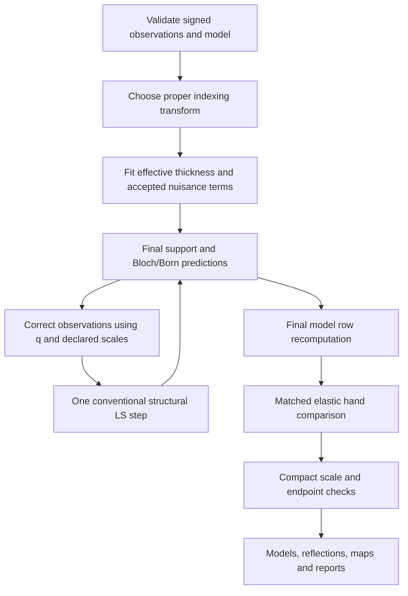

# GROND code map

Start with `src/grond/io/xds.py` for the observation geometry, `src/grond/bloch/model.py` for the atomic model and electron structure factors, and the modules in `src/grond/bloch` for a row's propagation. Then follow `src/grond/regularize` into `src/grond/refine` and the single/shared controllers in `src/grond/workflows`. The command line connects these parts; it is not the numerical implementation.

`src/grond/cli.py` preserves historical imports through explicit reexports. Argument registration lives in `src/grond/cli_options`, command handlers in `src/grond/commands`, execution/tool support in `src/grond/cli_support`, and report writers in `src/grond/reports`. Reexported function objects keep their defining module's globals. A test or extension that replaces a collaborator must replace it in the actual consumer module rather than assuming the CLI facade is a live proxy.

## Source ownership

| Area | Files to start with | Responsibility |
|---|---|---|
| Integration inputs | `src/grond/io/xds.py`, `src/grond/io/dials_bridge.py`, `src/grond/io/row_contract.py` | Signed observations, source uncertainties and measurement geometry. DIALS geometry, row selection and sigma helpers have separate modules. |
| PETS interoperability | `src/grond/io/pets_import.py`, `src/grond/io/pets_export.py`, `src/grond/io/pets_contract.py`, `src/grond/io/pets_geometry.py` | Preserve PETS-owned rows and validate optional import/export contracts. |
| DIALS subprocess readers | `src/grond/io/_dials_reader.py`, `src/grond/io/_dials_pets_helper.py` | Code run in a separately configured DIALS Python. These are package files, not dependencies of ordinary row prediction. |
| Atomic model | `src/grond/bloch/model.py` | SHELX/coreCIF reading, symmetry, occupancy, electron SFAC and displacement factors. |
| Bloch calculation | `src/grond/bloch/potential.py`, `src/grond/bloch/geometry.py`, `src/grond/bloch/profiles.py`, `src/grond/bloch/basis.py`, `src/grond/bloch/hamiltonian.py`, `src/grond/bloch/prediction.py` | Potential, excitation path, profile quadrature, beam support, matrix construction and integrated intensities. |
| Numerical contracts | `src/grond/bloch/config.py`, `src/grond/bloch/backends.py`, `src/grond/bloch/numerics.py` | Validated configuration, backend routing and numerical helpers. |
| Cache and reuse | `src/grond/bloch/cache.py`, `src/grond/bloch/row_plans.py`, `src/grond/bloch/row_cache.py`, `src/grond/regularize/prediction_cache.py` | Exact potential/row plans and outer prediction cache identity. |
| Row regularization | `src/grond/regularize/observations.py`, `src/grond/regularize/scales.py`, `src/grond/regularize/evaluation.py`, `src/grond/regularize/grid.py` | Target units, source sigma, fitted scales, candidate evaluation and nuisance-grid execution. |
| Row output and combination | `src/grond/regularize/row_output.py`, `src/grond/regularize/multidataset.py` | Preserve row evidence and form corrected multi-crystal endpoint observations. |
| Scale compression | `src/grond/regularize/compression_topology.py`, `src/grond/regularize/compression_weights.py`, `src/grond/regularize/compression_policy.py` | Frame grouping, work-row fits and prospective compact-contract gates. |
| Thickness response | `src/grond/regularize/thickness_response.py` | Cached eigensystem response, packed propagation and bounded searches. |
| Structural refinement | `src/grond/refine/parameters.py`, `src/grond/refine/geometry_restraints.py`, `src/grond/refine/native_objective.py`, `src/grond/refine/feedback_contract.py` | Native parameter updates and preservation of the frozen feedback contract. |
| SHELXL endpoints | `src/grond/refine/shelx_input.py`, `src/grond/refine/shelxl_iterations.py`, `src/grond/refine/shelxl_diagnostics.py`, `src/grond/refine/endpoints.py` | Instruction writing, bounded external calls, model health and endpoint registry. |
| Automatic workflow | `src/grond/workflows/single.py`, `src/grond/workflows/multi.py`, `src/grond/workflows/shared_refinement.py` | Stage ordering and one shared structural model across accepted crystals. |
| Scientific decisions | `src/grond/workflows/transform_selection.py`, `src/grond/workflows/final_hand_selection.py`, `src/grond/workflows/scale_selection.py`, `src/grond/workflows/endpoint_selection.py` | Proper transform, conditional hand evidence, scale and endpoint decisions. |
| Reports | `src/grond/reports/table1.py`, `src/grond/reports/quick_stats.py`, `src/grond/reports/terminal.py` | Separate row and SHELXL statistics, provenance and user output. |
| Maps | `src/grond/maps/native_dynamic.py`, `src/grond/workflows/finish_maps.py` | Ratio-derived native Fourier coefficients and optional corrected-HKL endpoint maps. |
| Protein adapters | `src/grond/macromolecule.py` | Fixed unique-HKL FreeR flags, corrected MTZ and explicit external endpoint templates. |

The historical engine scripts remain executable adapters where standalone commands, multiprocessing identities or established dispatch hooks need a stable location. `XDSBlochPort` remains defined in `src/grond/legacy/engine/bloch_engine.py`; its disjoint method groups come from the modern Bloch modules. `native_row_regularize.py` and the feedback scripts retain their command/dispatch boundary while using the domain modules. New numerical code should go in its owning domain, with an explicit compatibility reexport only when needed.

## One row through the calculation

For beam indices `g_i`, the excitation error forms the diagonal. The off-diagonal element is `U(g_j-g_i)/(2k)`, where `k=1/wavelength`, and propagation is `psi(t)=exp(2*pi*i*H*t) psi(0)`. The source model gives `U_g=gamma*F_e(g)/(pi*V)`. Read `hamiltonian.py` and its tests together when changing sign or matrix conventions: a transposition or conjugation can preserve some residuals while changing a hand comparison.

Elastic matrices use Hermitian propagation. Exactly uniform scalar imaginary absorption factors analytically; general loss requires the non-Hermitian path and the passive-loss check. The final inverse-hand identity is evaluated with the elastic contract. Profile and thickness quadrature average intensities, and the matched Born reference uses the same row support and normalization.

## From rows to a refined endpoint

The fast LS1 loop freezes `q=Idyn/Iborn` within a conventional model update and recomputes it at the next macrocycle. Its inner derivative omits the structural derivative of q. This boundary is why the native row objective and [LS1 controls](LS1_VALIDATION.md) matter even when the corrected-HKL endpoint R factor is attractive. Multi-crystal feedback recalculates each crystal using its own nuisance contract, combines corrected observations on an overlap scale, and updates one shared structure.

## Debugging and change discipline

For a suspicious row, follow its immutable source identity into the profile, support, Hamiltonian and propagation modules. For an unexpected selection, start from the decision JSON and its candidate rejection reasons. `grond_progress.json` and `logs/commands.jsonl` identify stages, commands and timing; they do not replace the numerical row table or endpoint artifacts.

The explicit manifests in `src/grond/bloch/source.py` and `src/grond/regularize/source.py` bind numerical implementations into cache fingerprints. Add a new numerical owner to the relevant manifest when moving or adding code. Hashing only a compatibility facade would leave cached predictions valid after its implementation changed.

Tests are organized by contract in `tests/physics`, `tests/io`, `tests/hand`, `tests/regularize`, `tests/refine`, `tests/workflows`, `tests/reporting`, `tests/package` and `tests/cli`. CLI cases are further split by functional area. Shared synthetic helpers are explicit test-package imports; repository-relative paths come from `tests/_support.py`. The full suite remains one ordinary pytest run. Historical data experiments are indexed separately and summarized in [BENCHMARKS.md](BENCHMARKS.md).
