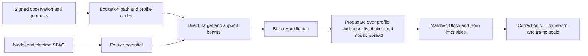
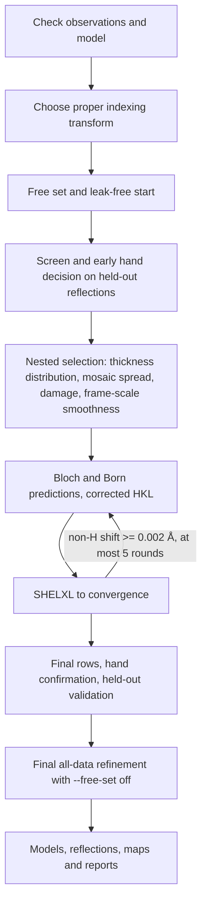

# GROND code map

Start with `src/grond/io/xds.py` for the observation geometry, `src/grond/bloch/model.py` for the atomic model and electron structure factors, and the modules in `src/grond/bloch` for the propagation of one observation. Then follow `src/grond/regularize` into `src/grond/refine` and the controllers in `src/grond/workflows`. The command line connects these parts; it is not the numerical implementation.

`src/grond/cli.py` is the console entry point only. Argument registration is in `src/grond/cli_options`, command handlers in `src/grond/commands`, execution and tool support in `src/grond/cli_support`, and report writers in `src/grond/reports`. Re-exported functions keep their defining module's globals, so a test or extension that replaces a collaborator must replace it in the module that uses it.

## Source ownership

| Area | Files to start with | Responsibility |
|---|---|---|
| Integration inputs | `src/grond/io/xds.py`, `src/grond/io/dials_bridge.py`, `src/grond/io/row_contract.py` | Signed observations, source uncertainties and measurement geometry. DIALS geometry, row selection and sigma helpers have separate modules. |
| PETS interoperability | `src/grond/io/pets_import.py`, `src/grond/io/pets_export.py`, `src/grond/io/pets_contract.py`, `src/grond/io/pets_geometry.py` | PETS2 import and `cif_pets` export. |
| DIALS subprocess readers | `src/grond/io/_dials_reader.py`, `src/grond/io/_dials_pets_helper.py` | Code run in a separately configured DIALS Python. |
| Atomic model | `src/grond/bloch/model.py` | SHELX and CIF reading, symmetry, occupancy, electron SFAC and displacement factors. |
| Bloch calculation | `src/grond/bloch/potential.py`, `src/grond/bloch/geometry.py`, `src/grond/bloch/profiles.py`, `src/grond/bloch/basis.py`, `src/grond/bloch/hamiltonian.py`, `src/grond/bloch/prediction.py`, `src/grond/bloch/thickness.py` | Potential, excitation path, profile quadrature, beam support, matrix construction, thickness distributions and integrated intensities. |
| Numerical settings | `src/grond/bloch/config.py`, `src/grond/bloch/backends.py`, `src/grond/bloch/numerics.py` | Validated configuration, backend routing and eigensolvers. |
| Cache and reuse | `src/grond/bloch/cache.py`, `src/grond/bloch/row_plans.py`, `src/grond/bloch/row_cache.py`, `src/grond/regularize/prediction_cache.py` | Potential and row plans, and the identity of cached predictions. |
| Observation fitting | `src/grond/regularize/observations.py`, `src/grond/regularize/scales.py`, `src/grond/regularize/evaluation.py`, `src/grond/regularize/grid.py` | Target units, source sigma, fitted scales, candidate evaluation and nuisance grids. |
| Frame scales | `src/grond/regularize/spline_scales.py` | P-spline frame scales in scan angle, fitted on working observations. The `compression_*.py` modules serve the optional per-frame scale model (`--scale-model per-frame`). |
| Nuisance selection | `src/grond/regularize/nested_selection.py`, `src/grond/workflows/nested_nuisance.py` | Per-crystal choice of thickness distribution (gamma or wedge, 10 nm to 1 µm), mosaic spread, damage and P-spline smoothness by inner cross-validation on working observations. |
| Thickness response | `src/grond/regularize/thickness_response.py` | Cached eigensystem response and bounded thickness searches. |
| Free set and held-out validation | `src/grond/validation/heldout.py`, `src/grond/validation/endpoint_free.py`, `src/grond/workflows/leak_free_start.py`, `src/grond/workflows/all_data_refinement.py` | Salted-hash free set, held-out R factors and bootstrap intervals, the orbit sign test for the hand, the leak-free start and the final all-data refinement. |
| Row output and combination | `src/grond/regularize/row_output.py`, `src/grond/regularize/multidataset.py` | The per-crystal row table and the merged corrected reflections of several crystals. |
| Structural refinement | `src/grond/refine/parameters.py`, `src/grond/refine/geometry_restraints.py`, `src/grond/refine/native_objective.py`, `src/grond/refine/feedback_contract.py` | Native parameter updates and the frozen corrections of each SHELXL round. |
| SHELXL | `src/grond/refine/shelx_input.py`, `src/grond/refine/shelxl_iterations.py`, `src/grond/refine/shelxl_diagnostics.py`, `src/grond/refine/endpoints.py` | Instruction writing, SHELXL calls to convergence, weight convergence, NPD recovery, model health and the endpoint registry. |
| Automatic workflow | `src/grond/workflows/single.py`, `src/grond/workflows/multi.py`, `src/grond/workflows/shared_refinement.py` | Stage order and one shared model across the accepted crystals. |
| Decisions | `src/grond/workflows/transform_selection.py`, `src/grond/workflows/final_hand_selection.py`, `src/grond/workflows/scale_selection.py`, `src/grond/workflows/endpoint_selection.py` | Indexing transform, hand, scales and the reported model. |
| Reports | `src/grond/reports/table1.py`, `src/grond/reports/quick_stats.py`, `src/grond/reports/heldout.py`, `src/grond/reports/terminal.py` | Row and SHELXL statistics, held-out validation and terminal output. |
| Maps | `src/grond/maps/native_dynamic.py`, `src/grond/workflows/finish_maps.py` | Native Fourier coefficients and the optional shelx2map maps. |
| Macromolecular adapters | `src/grond/macromolecule.py` | FreeR flags for unique reflections, corrected MTZ and external endpoint templates. |
| Manual workflow | `src/grond/manual/` | The `grond manual` stages. |

The engine scripts in `src/grond/legacy/engine` are run as subprocesses by the workflows and use the domain modules for the numerics. `XDSBlochPort` is defined in `src/grond/legacy/engine/bloch_engine.py`. New numerical code goes in its owning domain module.

## One observation through the calculation

For beam indices `g_i`, the excitation error forms the diagonal. The off-diagonal element is `U(g_j-g_i)/(2k)`, where `k=1/wavelength`, and propagation is `psi(t)=exp(2*pi*i*H*t) psi(0)`. The model gives `U_g=gamma*F_e(g)/(pi*V)`. Read `hamiltonian.py` and its tests together when changing sign or matrix conventions: a transposition or conjugation can leave some residuals unchanged while changing the hand comparison.

Without absorption (the default) the matrix is Hermitian. For a centrosymmetric model with the inversion centre at the origin it is real symmetric, and `bloch/numerics.py` then uses the real solver. Uniform scalar absorption factors out analytically; any other loss needs the non-Hermitian path and its passive-loss check. Both hands are computed from the same eigen-spectra with the negative-thickness identity. Profile and thickness quadrature average intensities, and the matched Born reference uses the same beams and normalization.

## From observations to a refined model (`grond auto`)

Each round freezes `q=Idyn/Iborn` for the current model, writes the corrected HKL and refines SHELXL to convergence against it (converged WGHT, no DAMP, ISOR on non-positive-definite atoms). The next round recalculates q for the new model; the thickness distribution and frame-scale smoothness are selected again for each new model. The derivative of q with respect to the structure is not part of the SHELXL step. With several crystals, each crystal is calculated with its own settings, the corrected observations are merged, and one shared model is refined.

## Debugging and change discipline

For a suspicious observation, follow its source identity into the profile, beam support, Hamiltonian and propagation modules. For an unexpected selection, start from the decision JSON and its rejection reasons. `grond_progress.json` and `logs/commands.jsonl` identify stages, commands and timing; they do not replace the row table or the SHELXL files.

The manifests in `src/grond/bloch/source.py` and `src/grond/regularize/source.py` bind numerical implementations into cache fingerprints. Add a new numerical module to the relevant manifest when moving or adding code; hashing only a re-export would leave cached predictions valid after the implementation changed.

Tests are flat `tests/test_*.py` files, run as one ordinary pytest suite ([DEVELOPMENT.md](DEVELOPMENT.md)). Repository paths come from `tests/_support.py`.
