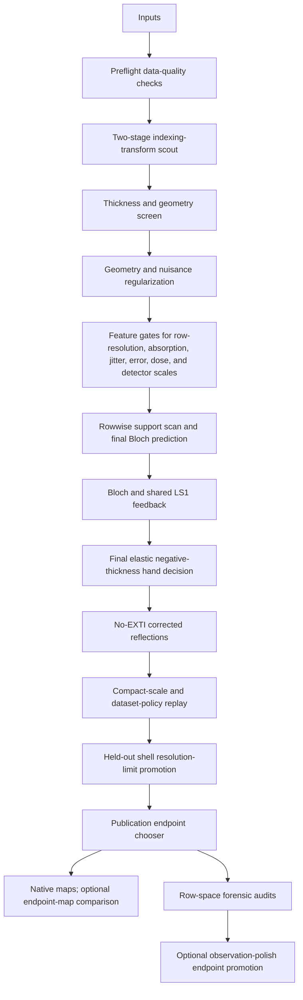

# Workflow

GROND is staged so that cheap checks control expensive calculations. A source-level map of the files behind this workflow is in [CODE_MAP.md](CODE_MAP.md).

The report-quality LaTeX/TikZ workflow figures live in [docs/figures](figures/README.md). The master source is [grond_workflow_figures.tex](figures/grond_workflow_figures.tex), which builds one overview figure plus detailed figures for the conventional pre-GROND path, the GROND reintegration/intake path, reflection-ledger creation, automatic decisions, physical alignment and thickness selection, Bloch/regularization, nuisance gates, endpoint/map output, multi-dataset prep, and run-mode cost. Small examples of the files shown in the diagrams are in [FILE_FORMATS.md](FILE_FORMATS.md).

The automatic path rejects branches that do not improve the selected score. This is deliberate: a physically plausible correction should improve the row model or endpoint statistics without requiring a giant blind grid search. Transform alignment is now explicitly two-stage: every requested signed HKL transform gets a cheap low-N/Q pass, then only the top candidates are rerun at better N/Q before one alignment is pinned for the rest of the workflow. Resolution-dependent intensity envelopes are tested in the raw-row dynamical target as `row_resolution_b`; corrected-HKL endpoint-B scans remain opt-in, auditable no-EXTI diagnostics rather than the primary regularization target, and B=0 is the normal final endpoint. Full auto also tests detector-position scale fields as a bounded grid and records which scale field was promoted.

Scale parameters are treated as measured-data nuisance parameters, not hidden structural parameters. GROND's default `--group-width-grid auto` resolves from the XDS oscillation range and tests one-frame, two-frame, three-frame, 1 degree, 2 degree, 3 degree, and 5 degree frame-scale groups during the main nuisance search, skipping any fixed degree value that would be smaller than one physical frame. After the final Bloch row table is written, the scale-polish gate tries to replace the dense frame-scale curve with an adaptive neighboring-frame segmentation while independently testing detector-free, 2x2, 4x4, and diagnostic 8x8 fields. Detector factors are shrunk toward unity and spatially smoothed. A detector field must improve multiple held-out splits, preserve the Born-to-Bloch advantage, have adequate support in every tile, reproduce across data halves, and agree between Born- and Bloch-based fits. The endpoint replay then promotes the smallest contract that also passes the NPD, split, residual-cost, and held-out-row gates. Fixed-weight GooF and modulation p95 outside their preferred ranges are reported as warnings rather than model-handoff gates. Frame and detector parameter counts are reported separately. See `DETECTOR_SCALE_POLICY.md` for the complete contract.

Multi-dataset jobs have an explicit inclusion policy. GROND first evaluates the per-crystal row model and coverage before shared structure update, then repeats the policy after final row predictions. Datasets that track the best crystal set are `primary`; datasets that are useful but noisier are `downweight` and enter raw-row regularization with inflated sigmas; datasets that are too weak for gradients but add nonredundant reflections are `completeness_only` and contribute to corrected-HKL endpoint coverage without entering shared-model row metrics. Before endpoint merging, each dataset can receive its own uniform-Z endpoint sigma calibration, then the corrected reflections are put onto a common post-dynamical scale using overlapping symmetry-equivalent rows. The merged endpoint then uses a chi-square overdispersion rule by default: if several datasets measuring the same reflection disagree more than their formal sigmas predict, the merged sigma is inflated rather than pretending the average is more certain. This keeps completeness gains visible while preventing one bad crystal, one optimistic sigma model, or one badly scaled crystal from steering ADPs or coordinates.

Final basis size is selected by a cheap support-only scan before the expensive Q20 polish. GROND counts the actual Sg-limited basis size required by each selected row, then uses `max_observed_basis + 10` with `--final-basis-max 500` as the default limit. The support top-up depth follows the selected data resolution; for example, a 0.70 A final endpoint is not silently supported by only 0.80 A top-up beams. This gives each dataset the beams it actually asks for without making every final run pay for a fixed 500-beam calculation. The `--full-fast` profile deliberately bypasses this expensive final polish and pins N/Q to a cheap value while leaving the automatic decision tree active. In that profile, the structure-update budget is also chosen from the model size so larger models do not spend several minutes on a diagnostic ADP probe before the final row evaluation.

Rocking-profile quadrature is explicit. GROND samples the target reflection over the selected Sg window with `--profile-quadrature uniform` by default; `trapezoid` and `gauss_legendre` are available diagnostics. The default `--profile-accumulation sum` stores `Idyn` and `Iborn` as summed detector sub-exposures rather than normalized averages, which is the right convention for future raw-CBF forward modelling. The legacy normalized convention is still available as `--profile-accumulation mean`. Because `Idyn` and `Iborn` use the same accumulation, the dynamical correction ratio `q=Idyn/Iborn` is unchanged by the sum-vs-mean normalization and frame/group scales absorb the global factor.

Resolution-limit promotion is a row-table audit, not another expensive grid search. After the final dynamic predictions exist, GROND bins rows into resolution shells and promotes the highest shell that keeps enough signal, stable split-half agreement, acceptable shell and cumulative GROND row/MR `MwRall`, and no excessive held-out work/free penalty when the split has enough rows to support that test. The same gate is run per dataset and, for multi-dataset jobs, once more on the combined endpoint so the reported final limit reflects both individual-crystal behavior and the merged scientific result.

SHELXL endpoint polishing is iterative in full mode. Before final corrected endpoints and before each high-N/Q `Bloch -> SHELXL` feedback update, GROND applies a post-Bloch uniform `z`-RMS sigma calibration unless the user disables it. This fits one model scale for the current corrected HKL, measures the root-mean-square normalized residual `(Iobs - K Fc^2)/sigma`, and multiplies every endpoint sigma by that single scalar. The reason is practical and statistical: measured intensities disagree for many non-structural reasons, and after Bloch regularization the endpoint is no longer the raw integrated observation. Keeping the inherited integration sigmas forever can make GooF and `wR2all` describe stale uncertainty rather than the transformed endpoint. Intensities, Bloch ratios, endpoint-B, frame scales, and nuisance parameters are not changed. The policy is on by default only at final endpoint and feedback boundaries, not during early transform, thickness, absorption, jitter, or scale selection.

Each corrected-HKL endpoint declares its SHELXL weight policy. The production publication path uses calibrated endpoint sigmas with fixed `WGHT 0 0`, so stale kinematic weights from the starting model do not silently control a dynamical endpoint. GROND can still run inherited or promoted SHELXL empirical weights as compatibility diagnostics, but those branches are not allowed to replace a calibrated fixed-weight publication endpoint just because they lower a weight-sensitive statistic. Endpoint `.res` files are normalized for reopening: one active LS/CGLS cycle, the corrected-HKL `HklSrc`, one active pre-`END` `WGHT`, and no ignored post-`END` recommendation tail. GROND reports both the weight policy and the final GooF because low `wR2all` with a low GooF can simply mean the endpoint weights are too broad for the residuals being judged.

The publication endpoint chooser is the final endpoint sanity check. It reports the best physical endpoint separately from the best single-dataset physical diagnostic and the lowest-residual rejected diagnostic endpoint, then lists rejected corrections with explicit reasons. For multi-dataset jobs, the combined endpoint remains the publication endpoint when it passes the physical gate, even when one crystal has a lower residual by itself. A physical endpoint must be no-EXTI, endpoint-B zero, safely scaled, finite, and free of disallowed NPD pathology. Nonzero endpoint-B, explicit EXTI, unsafe HKL rescaling, and unaccepted observation-polish corrections remain diagnostic-only. Excessive modulation, non-ideal GooF, a missing conventional comparison, or a worse conventional R1all comparison are warnings attached to an otherwise usable model.

The Bloch/LS1 structure-update path has its own validation workflow because it is a lagged surrogate, not exact native dynamical least squares. `GROND validate-ls1` reruns updated-q feedback cycles from a pinned nuisance summary, compares them with frozen-q and q=1 controls, optionally runs an alternate-hand Bloch control, and can finish with a matched-physics native finite-difference polish. The report answers whether the row-level `q` correction is doing real dynamical work and whether native polish still finds a material downhill direction. See [LS1_VALIDATION.md](LS1_VALIDATION.md).
