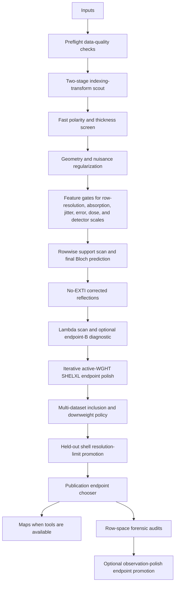

# Workflow

GROND is staged so that cheap checks control expensive calculations. A source-level map of the files behind this workflow is in [CODE_MAP.md](CODE_MAP.md).

The publication-quality LaTeX/TikZ workflow figures live in [docs/figures](figures/README.md). The master source is [grond_workflow_figures.tex](figures/grond_workflow_figures.tex), which builds one overview figure plus detailed figures for the conventional pre-GROND path, the GROND reintegration/intake path, reflection-ledger creation, automatic decisions, physical alignment and thickness selection, Bloch/regularization, nuisance gates, endpoint/map output, multi-dataset prep, and run-mode cost. Small examples of the files shown in the diagrams are in [FILE_FORMATS.md](FILE_FORMATS.md).

The automatic path rejects branches that do not improve the selected score. This is deliberate: a physically plausible correction should improve the row model or endpoint statistics without requiring a giant blind grid search. Transform alignment is now explicitly two-stage: every requested signed HKL transform gets a cheap low-N/Q pass, then only the top candidates are rerun at better N/Q before one alignment is pinned for the rest of the workflow. Resolution-dependent intensity envelopes are tested in the raw-row dynamical target as `row_resolution_b`; corrected-HKL endpoint-B scans remain opt-in, auditable no-EXTI diagnostics rather than the primary regularization target, and B=0 is the normal final endpoint. Full auto also tests detector-position scale fields as a bounded grid and records which scale field was promoted.

Scale parameters are treated as measured-data nuisance parameters, not hidden structural parameters. GROND's default `--group-width-grid auto` resolves from the XDS oscillation range and tests one-frame, two-frame, three-frame, 1 degree, 2 degree, 3 degree, and 5 degree frame-scale groups during the main nuisance search, skipping any fixed degree value that would be smaller than one physical frame. After the final Bloch row table is written, the scale-polish gate now tries to replace the dense frame-scale curve with an adaptive neighboring-frame segmentation of the fitted scale manifold while preserving the exact detector-position scale grid by default. A compressed scale model is promoted only when all-row gates stay within tolerance for GROND row/MR `Rall`/`wRall` and native `R1all`/`wR2all`; strong-row metrics are reported but are not allowed to dominate this decision. If a dataset genuinely needs near-frame-level scales, GROND reports that rather than forcing a smoother model that gives worse physics. Explicit sub-frame numeric scale windows remain available for diagnostics, but they are no longer part of automatic production runs.

Multi-dataset jobs have an explicit inclusion policy. GROND first evaluates the per-crystal row model and coverage before shared structure update, then repeats the policy after final row predictions. Datasets that track the best crystal set are `primary`; datasets that are useful but noisier are `downweight` and enter raw-row regularization with inflated sigmas; datasets that are too weak for gradients but add nonredundant reflections are `completeness_only` and contribute to corrected-HKL endpoint coverage without entering shared-model row metrics. Before endpoint merging, the corrected reflections are put onto a common post-dynamical scale using overlapping symmetry-equivalent rows, so arbitrary raw integration scale offsets do not survive into the final multi-crystal HKL. This keeps completeness gains visible while preventing one bad crystal or one badly scaled crystal from steering ADPs or coordinates.

Final basis size is selected by a cheap support-only scan before the expensive Q20 polish. GROND counts the actual Sg-limited basis size required by each selected row, then uses `max_observed_basis + 10` with `--final-basis-max 500` as the default limit. The support top-up depth follows the selected data resolution; for example, a 0.70 A final endpoint is not silently supported by only 0.80 A top-up beams. This gives each dataset the beams it actually asks for without making every final run pay for a fixed 500-beam calculation. The `--full-fast` profile deliberately bypasses this expensive final polish and pins N/Q to a cheap value while leaving the automatic decision tree active. In that profile, the structure-update budget is also chosen from the model size so larger models do not spend several minutes on a diagnostic ADP probe before the final row evaluation.

Rocking-profile quadrature is explicit. GROND samples the target reflection over the selected Sg window with `--profile-quadrature uniform` by default; `trapezoid` and `gauss_legendre` are available diagnostics. The default `--profile-accumulation sum` stores `Idyn` and `Iborn` as summed detector sub-exposures rather than normalized averages, which is the right convention for future raw-CBF forward modelling. The legacy normalized convention is still available as `--profile-accumulation mean`. Because `Idyn` and `Iborn` use the same accumulation, the dynamical correction ratio `q=Idyn/Iborn` is unchanged by the sum-vs-mean normalization and frame/group scales absorb the global factor.

Resolution-limit promotion is a row-table audit, not another expensive grid search. After the final dynamic predictions exist, GROND bins rows into resolution shells and promotes the highest shell that keeps enough signal, stable split-half agreement, acceptable shell and cumulative GROND row/MR `MwRall`, and no excessive held-out work/free penalty when the split has enough rows to support that test. The same gate is run per dataset and, for multi-dataset jobs, once more on the combined endpoint so the reported final limit reflects both individual-crystal behavior and the merged scientific result.

SHELXL endpoint polishing is iterative in full mode. After each SHELXL cycle, GROND reads the recommended `WGHT`, moves it into the active pre-`END` input block, strips the ignored post-`END` tail from the working `.ins`, and reruns the endpoint polish. This prevents stale weighting from masquerading as missing physics and makes `wR2all` comparable across endpoint candidates.

The publication endpoint chooser is the final endpoint sanity check. It reports the best physical endpoint separately from the best single-dataset physical diagnostic and the lowest-residual rejected diagnostic endpoint, then lists rejected corrections with explicit reasons. For multi-dataset jobs, the combined endpoint remains the publication endpoint when it passes the physical gate, even when one crystal has a lower residual by itself. A physical endpoint must be no-EXTI, endpoint-B zero, safely scaled, and finite; nonzero endpoint-B, explicit EXTI, unsafe HKL rescaling, excessive modulation, and unaccepted observation-polish corrections remain visible but diagnostic-only.
